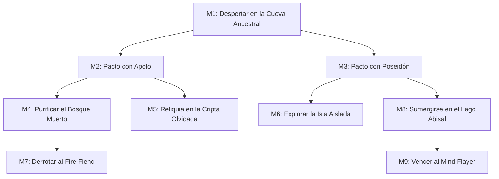

# Aventura Algorítmica: The Ballad of Nyx

---

## 1. Explicación Breve y Decisiones del Equipo
En esta fase del proyecto (*Checkpoint 2* y *Checkpoint 3*, semanas 1 a 15), hemos integrado de forma modular los componentes del juego: la gestión de inventario en `inventario.py`, la pila de historial y retroceso en `historial.py`, la cola de turnos y eventos en `eventos.py`, la generación recursiva de mazmorras en `mazmorra.py`, el diccionario de estado del mundo en `estado_mundo.py`, el mapa del mundo como grafo con BFS/DFS en `grafo.py` y el árbol de misiones con recorridos en `misiones.py`. Siguiendo la regla de "un archivo, una responsabilidad", cada submódulo maneja su propia lógica de datos y se comunica con `main.py` para que todas las estructuras trabajen juntas durante la partida.

---

## 2. Guía de Inicio y Cómo Jugar
Para desplegar y jugar *The Ballad of Nyx* desde tu terminal:

1. Clona el repositorio asegurándote de mantener la siguiente estructura modular de archivos:
   ```text
   The_Ballad_of_Nyx/
   ├── main.py            # Módulo principal y bucle de juego
   ├── inventario.py      # Lista (Semana 3)
   ├── historial.py       # Pila (Semana 5)
   ├── eventos.py         # Cola (Semana 6)
   ├── mazmorra.py        # Recursión (Semana 7)
   ├── grafo.py           # Grafo, BFS y DFS (Semanas 12-13)
   ├── estado_mundo.py    # Diccionario / Tabla Hash (Semana 15)
   ├── misiones.py        # Árbol de misiones (Semana 14)
   └── README.md
   ```

2. Abre tu terminal en la carpeta raíz del proyecto y ejecuta:
   ```bash
   python main.py
   ```

3. **Mecánicas en la Consola (Funcionalidades actuales):**
   - Selecciona tu deidad aliada para definir las bonificaciones de elemento y daño.
   - Administra tu inventario, craftea elixires y enfréntate a enemigos en combates por turnos ordenados mediante una cola eficiente.
   - Explora la mazmorra recursiva o navega por el **Mapa del Mundo (Grafo)** calculando rutas más cortas/alternativas con **BFS** y detectando zonas alcanzables/aisladas con **DFS**.
   - Consulta y completa misiones en el **Árbol de Misiones** (recorrido en preorden y por niveles) para recibir recompensas reales y desbloquear la zona aislada del *Santuario Oculto*.
   - Consulta el **Estado del Mundo** en tiempo real y utiliza el historial para deshacer acciones.

---

## 3. Concepto del Juego (Semana 1)
- **Mundo:** Un universo de fantasía oscura donde la magia elemental y el favor de los dioses olímpicos dictan el destino de los guerreros.
- **Protagonista:** Nyx Rigel, una guerrera que canaliza el poder, armas y elementos del dios que elija como aliado.
- **Antagonista:** Criaturas elementales y espectros oscuros (Fire Fiend, Water Zombie, Earth Golem, Vengeful Spirit, Mind Flayer) que amenazan el balance.
- **Objeto Especial:** Reliquias, elixires y plantas medicinales (`herbs`, `ginsing`, `health_potion`, `mana_potion`, `strength_elixir`) que restauran salud, maná o mejoran el ataque.
- **Problema a Resolver:** Nyx debe sobrevivir a hordas de enemigos y navegar por laberintos oscuros administrando estratégicamente su inventario y sus decisiones tácticas.

---

## 4. Justificación Técnica y Complejidad O(1) de las Estructuras Lineales

### A. Cola de Turnos y Eventos (`eventos.py`) - Uso de `deque`
- **Estructura elegida:** `collections.deque` (Double-Ended Queue).
- **Justificación algorítmica:** La gestión de turnos de combate y el flujo de eventos secuenciales del mapa opera bajo la regla FIFO (*First-In, First-Out*). Si utilizáramos una lista tradicional (`list.pop(0)`), Python desplazaría todos los elementos restantes generando una complejidad $O(n)$. Con `deque`, `.append()` y `.popleft()` operan en tiempo constante **$O(1)$**.

### B. Historial de Acciones y Retroceso (`historial.py`) - Uso de Pila (Stack)
- **Estructura elegida:** Lista de Python operada bajo el principio LIFO (*Last-In, First-Out*).
- **Justificación algorítmica:** La mecánica de "deshacer" (*undo*) exige retirar exactamente la última acción ejecutada. Usando `.append()` (*push*) y `.pop()` (*pop*) en el extremo derecho de la lista, garantizamos complejidad **$O(1)$** en ambas operaciones.

---

## 5. Árbol de la Mazmorra y Decisiones de Diseño (`mazmorra.py`)
- **Estructura de Exploración:** Las salas y rutas se generan mediante algoritmos recursivos de ramificación variable y control de profundidad, modelando un **Árbol de Decisiones** donde las elecciones de la jugadora abren nuevos caminos asimétricos.

### Representación del Árbol de la Mazmorra
```text
Cueva Ancestral (Raíz - Nivel 0)
├── Isla Aislada (Nivel 1)
│   ├── Bosque Muerto (Nivel 2 - Callejón sin salida)
│   ├── Volcán Extraño (Nivel 2 - Callejón sin salida)
│   └── Cripta Olvidada (Nivel 2 - Callejón sin salida)
└── Templo en Ruinas (Nivel 1)
    ├── Lago Abisal (Nivel 2 - Callejón sin salida)
    └── Altar Oscuro (Nivel 2 - Callejón sin salida)
```

---

## 6. Mecánica del Inventario con Listas (`inventario.py`)
La manipulación del inventario de Nyx se apoya en los métodos nativos de listas en Python:
- **Agregar Objetos (`Add_item_to_inventory`):** Valida la capacidad máxima antes de añadir con `.append()` y registra la acción en la pila del historial.
- **Usar Objetos (`use_item`):** Enumera los ítems con `enumerate(inventory, 1)`, aplica efectos sobre la salud/maná y elimina el objeto usado con `.pop(choice_idx)`.
- **Soltar Objetos (`throw_item`):** Guarda una copia previa en el historial y vacía el inventario con `.clear()`.

---

## 7. Diccionario de Estado del Mundo (`estado_mundo.py`) y Complejidad O(1)

### ¿Por qué el diccionario es $O(1)$ en promedio frente a $O(n)$ en una lista?
En Python, un diccionario (`dict`) está implementado internamente como una **tabla hash**. Cuando consultamos, insertamos o actualizamos una clave inmutable (como `("sala", "Bosque Muerto")` o `"nyx_ubicacion"`), Python aplica una función hash que calcula directamente la posición en memoria donde reside el valor. Esto permite acceder a los datos en tiempo constante **$O(1)$ en promedio**, sin importar cuántas salas o entidades existan en el mundo.

En contraste, si guardáramos el estado de cada sala en una **lista**, verificar si una sala fue visitada o si un jefe fue derrotado obligaría a recorrer los elementos secuencialmente uno por uno hasta encontrarlo, lo que representa una complejidad lineal **$O(n)$** que se degrada conforme crece el mapa.

### Decisión de diseño: ¿Qué ocurre con `estado_mundo` al usar *Deshacer*?
Cuando Nyx se desplaza a una nueva sala, `historial.py` apila no solo la `sala_origen`, sino también la `sala_destino` y el estado que tenía esa sala antes de entrar (`"sin_visitar"` o `"visitada"`). Al ejecutar **Deshacer**, el sistema revierte `nyx_ubicacion` a la sala anterior y restaura la sala destino a su estado previo en `estado_mundo`. De esta forma, si Nyx entra por primera vez a una sala y deshace el movimiento, la sala vuelve a marcarse como `"sin_visitar"`, manteniendo el estado global consistente con la línea temporal del jugador.

### Evidencia de ejecución (Casos límite y Estado del Mundo)
```text
--- [Menú] MENÚ PRINCIPAL ---
Elige una opción: hola
[Sistema] Opción inválida. Por favor ingresa un número del 1 al 9.
Elige una opción: -3
[Sistema] Opción inválida. Por favor ingresa un número del 1 al 9.
Elige una opción: 0
[Sistema] Opción inválida. Por favor ingresa un número del 1 al 9.
Elige una opción: 6

--- [Estado del Mundo] RESUMEN GLOBAL ---
  Ubicación actual de Nyx : Cueva Ancestral
  Dios aliado             : Apolo
  Salas exploradas        : 1 / 9
  Jefes derrotados        : 0 / 2
-----------------------------------------
  Salas aún sin visitar : ['Isla Aislada', 'Templo en Ruinas', 'Bosque Muerto', ...]
  Jefes aún con vida    : ['fire_fiend', 'mind_flayer']
```

---

## 8. Mapa del Mundo como Grafo, BFS y DFS (`grafo.py`)

### ¿Por qué un Grafo con Lista de Adyacencia es la estructura adecuada?
A diferencia de un árbol (donde solo existe un único camino entre dos salas y no hay ciclos), el mapa del mundo de *The Ballad of Nyx* necesita **ciclos, caminos alternativos y la posibilidad de tener zonas aisladas** (como el `Santuario Oculto`). Implementamos una clase genérica `Grafo` reutilizable mediante una **lista de adyacencia** (diccionario donde cada nodo apunta a su lista de vecinos), lo cual ahorra memoria frente a una matriz de adyacencia en mapas dispersos y permite consultar las conexiones de cualquier sala de forma directa.

### Integración con las demás estructuras del juego
- **Con `estado_mundo.py` (Diccionario):** Al viajar por el grafo se actualiza `nyx_ubicacion` y se marca cada sala como `"visitada"`. Además, tanto **BFS** como **DFS** consultan las salas `"bloqueada"` del diccionario mediante `filtrar_por_estado("sala", "bloqueada")` para calcular rutas alternativas reales en tiempo de ejecución.
- **Con `historial.py` (Pila):** Cada desplazamiento entre salas del grafo queda registrado en la pila de historial.

### Análisis de Complejidad Temporal
Sea $V$ el número de nodos (salas) y $E$ el número de aristas (caminos):
- **`agregar_nodo` / `existe_nodo`:** **$O(1)$ promedio**, al apoyarse en las claves del diccionario de adyacencia.
- **`bfs_ruta_mas_corta` (Búsqueda en Anchura):** **$O(V + E)$**. Utiliza una cola (`collections.deque`) para explorar el mapa nivel por nivel, garantizando encontrar la ruta con **menos saltos** entre la ubicación actual de Nyx y cualquier destino (o una ruta alternativa si hay salas bloqueadas).
- **`dfs_zonas_alcanzables` y `detectar_zonas_aisladas` (Búsqueda en Profundidad):** **$O(V + E)$**. Explora recursivamente cada rama alcanzable para determinar qué regiones del mundo son accesibles desde la posición actual y cuáles permanecen aisladas o bloqueadas.

### Diagrama del Grafo del Mundo (`construir_mapa_nyx`)
```text
                        [Cueva Ancestral]
                         /             \
                        /               \
               [Isla Aislada]       [Templo en Ruinas]
                /         \          /      |       \
               /           \        /       |        \
      [Bosque Muerto]     [Lago Abisal]     |     [Altar Oscuro]
        /         \                         |          /
       /           \                        |         /
[Volcán Extraño]   [Cripta Olvidada]--------+        /
       \                                            /
        +------------------------------------------+

      [Santuario Oculto]   (Zona aislada - sin conexiones)
```

---

## 9. Árbol de Misiones (`misiones.py`)

### ¿Por qué un árbol?
Las misiones de Nyx dependen unas de otras: una misión solo se puede hacer cuando su misión "padre" ya está completada. Esa relación padre-hijo es justo lo que representa un árbol. Hay 9 misiones, 4 niveles (altura 3) y una sola misión inicial (M1).

### Diagrama del árbol


| Nivel | Misiones |
|-------|----------|
| 0 | M1 |
| 1 | M2, M3 |
| 2 | M4, M5, M6, M8 |
| 3 | M7, M9 |

### Recorridos y para qué sirven
| Recorrido | Para qué lo usamos en el juego | Complejidad |
|-----------|-------------------------------|-------------|
| **Preorden** (recursivo) | Imprime el árbol con sangría y muestra qué misiones están completadas, disponibles o bloqueadas (menú 8 → 1). | O(n) |
| **Por Niveles** (BFS con `deque`) | Agrupa las misiones por etapa (Nivel 0 a 3), muestra el avance de cada etapa y la etapa actual del jugador (menú 8 → 2). | O(n) |
| Buscar / completar misión | Recorre el árbol para encontrar la misión por su ID. | O(n) |

`n` = número de misiones. Cada misión se visita una sola vez. El espacio extra es O(h) en Preorden (altura del árbol) y O(ancho del nivel) en Por Niveles.

### Cómo se conecta con las demás estructuras
- **Inventario (lista):** al completar una misión, Nyx recibe un ítem real con `inventario.Add_item_to_inventory`.
- **Grafo (BFS/DFS):** al completar M4 o M8 se agrega la arista `Altar Oscuro — Santuario Oculto`. La zona aislada pasa a ser alcanzable y BFS/DFS lo reflejan al instante.
- **Diccionario (`estado_mundo`):** el progreso se guarda con claves `("mision", "M1")` → `completada | disponible | bloqueada`, y también `ultima_mision_completada`.
- **Progresión:** al completar una misión se desbloquean sus misiones hijas y Nyx recupera HP o PM al azar.

### Casos límite que maneja el árbol
Misión inexistente (`M99`, texto, `0`, negativos, vacío), misión bloqueada (su padre no está completo), misión ya completada, e inventario lleno cuando la misión da un ítem. En todos los casos el juego muestra un mensaje y continúa.

### ¿Qué pasa con el estado del mundo al deshacer?
- Completar una misión es un **evento de historia permanente**: no se registra en la pila de `historial.py`, así que la opción "Deshacer" no la revierte.
- El ítem de recompensa sí entra al historial como acción `recoger`. Si se deshace, Nyx pierde ese ítem, pero la misión sigue `completada` en el árbol y en el diccionario.
- Mover a Nyx entre salas sí se deshace, restaurando `nyx_ubicacion` y el estado de la sala en `estado_mundo`.
- Si se genera una mazmorra nueva (opción 5), `estado_mundo` se reinicia, pero el progreso de las misiones se vuelve a copiar desde el árbol.

---

## 10. Aportes Individuales de los Integrantes
- **Esteban Ademir Cañas Rojas (`ademir1234-dot`):**
  - *Checkpoint 2:* Integración principal en `main.py`, validación de casos límite y experiencia de usuario.
  - *Checkpoint 3:* Implementación de la clase genérica `Grafo` con lista de adyacencia en `grafo.py`, algoritmos **BFS** (ruta más corta y rutas alternativas ante salas bloqueadas) y **DFS** (zonas alcanzables y detección de zonas aisladas), integración interactiva del Mapa del Mundo en `main.py` conectado con `estado_mundo.py` e `historial.py`, y documentación técnica de grafos ($O(V + E)$ y diagrama) en `README.md`.
- **Louis Alejandro Soto (`UnspokenLegion`):**
  - *Checkpoint 2:* Arquitectura del repositorio, gestión de Pull Requests y base del `README.md`.
  - *Checkpoint 3:* Implementación del módulo `estado_mundo.py` (diccionario con `.get()`, inserción, eliminación y funciones de resumen/filtro), sincronización de `estado_mundo` con el sistema de deshacer en `historial.py`, validación de casos límite y documentación de complejidad $O(1)$ en `README.md`.
- **Carlos Mario Alas Parada (`MarioAlas06`):**
  - *Checkpoint 2:* Documentación teórica, diagramas de flujo, tabla de complejidad y pseudocódigo (Semanas 5, 6 y 7).
  - *Checkpoint 3:* Diseño e implementación del Árbol de Misiones `misiones.py` con recorridos Preorden y Por Niveles (**BFS** con `deque`), validación de casos límite, integración en `main.py` (opción 8) conectándolo con el inventario, el grafo (Santuario Oculto) y el diccionario de estado del mundo, y documentación de la sección del árbol en `README.md`.

---

## 11. Evidencia de Ejecución
Revisar capturas y evidencias adjuntas en la carpeta `Evidencia/` del repositorio.